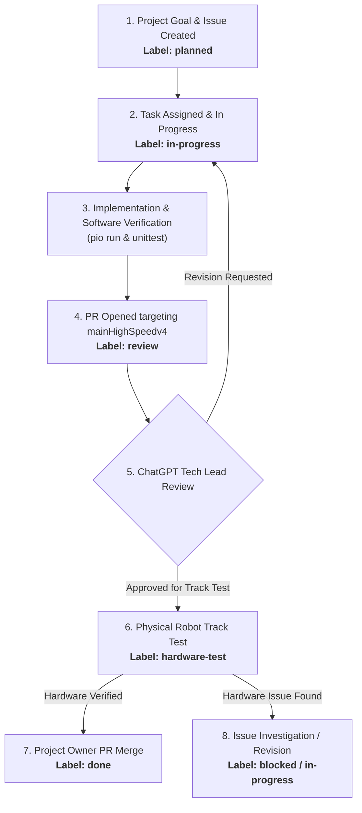

# Development Workflow — HighSpeedRobot Collaboration

**Repository:** `https://github.com/HwgKT/doline17s`  
**Primary Development Baseline:** `mainHighSpeedv4`  
**Framework:** ESP32, Arduino Framework, PlatformIO, Python Debug Application  

---

## 1. Multi-Agent Roles and Responsibilities

Development is coordinated across three primary roles with clear boundaries:

| Role | Entity | Responsibilities |
|---|---|---|
| **Technical Lead** | ChatGPT | Analyzes technical problems, designs control strategies and experiments, drafts technical specifications and acceptance criteria, reviews commits and PR diffs, and assigns subsequent development tasks. |
| **Implementation Agent** | Antigravity | Inspects the repository, implements approved tasks, processes logs, builds and tests software, manages Git feature branches, pushes changes, and creates Pull Requests with standardized reports. |
| **Project Owner** | User | Defines project goals, performs physical track tests, approves control strategy modifications, and authorizes merges into the baseline branch. |

**GitHub is the single source of truth for all shared engineering state.**

---

## 2. Branch Management Policy

- The active development baseline is **`mainHighSpeedv4`**. It represents the stable reference implementation.
- **Never commit directly to `mainHighSpeedv4`** unless explicitly instructed and authorized.
- For each assigned task:
  1. Fetch latest remote changes: `git fetch origin`.
  2. Inspect local working tree to ensure uncommitted changes are preserved.
  3. Create a dedicated feature branch off `origin/mainHighSpeedv4`:
     ```bash
     git checkout -b feat/<issue-number>-<short-task-name> origin/mainHighSpeedv4
     ```
  4. Implement changes strictly within the feature branch.
  5. Build and test software (`pio run`, `python -m unittest`).
  6. Commit only relevant modified files with clear, descriptive commit messages.
  7. Push to GitHub: `git push origin feat/<issue-number>-<short-task-name>`.
  8. Open a Pull Request targeting `mainHighSpeedv4`.
- **Never merge Pull Requests automatically.** Only the Project Owner authorizes merges.
- **Prohibited operations:** Never use `git reset --hard`, force push, or destructive Git commands that might overwrite uncommitted work or branch history.

---

## 3. GitHub Task Lifecycle & Workflow Labels

Tasks move through a structured lifecycle represented by GitHub labels:



### Standard Labels:
- `planned`: Task approved by Technical Lead and Project Owner, queued for implementation.
- `in-progress`: Currently being implemented on a feature branch.
- `review`: Pull Request submitted; awaiting Technical Lead review.
- `hardware-test`: Software verified; awaiting physical robot validation on track.
- `blocked`: Work suspended pending missing information, hardware issues, or dependencies.
- `done`: Hardware validated and Pull Request merged.

---

## 4. Control Algorithm Protection Rules

This repository controls a high-speed physical robot. Uncontrolled changes pose severe risks of hardware collision and damage.

Unless explicitly specified in an approved task issue, **DO NOT modify**:
1. PID gains (`Kp`, `Ki`, `Kd`) or controller structure.
2. Sensor weights or line-position calculations (`SENSOR_WEIGHTS`).
3. Active sensor masks or sensor threshold logic.
4. Encoder calibration or tick counting routines.
5. Motor direction, pin mapping, or PWM clamping.
6. Speed profiles and speed transition curves.
7. Early-turn, pre-turn, or sharp-turn detection mechanisms.
8. Line-loss detection, timeout, or search-recovery behavior.
9. Bluetooth SPP communication protocol and telemetry formats.
10. Safety and emergency-stop mechanisms.

**Safety rule:** Never disable or weaken safety protections or line-loss stops solely to reduce lap times.

---

## 5. Pull Request Standards

Every Pull Request must be created using `.github/PULL_REQUEST_TEMPLATE.md` and include:

1. **Task Reference:** Linked GitHub Issue number, base branch, baseline commit SHA, feature branch, and final commit SHA.
2. **Implementation Summary:** Exact files and functions modified, algorithms changed, and contrast between previous and new behavior.
3. **Verification Evidence:** Build commands (`pio run`), test suite results (`unittest`), log references, and metrics.
4. **Risk Assessment:** Regressions analysis, interaction with PID/motor/sensor modules, and rollback instructions.
5. **Validation Status:** Clearly state whether the change is `IMPLEMENTED`, `BUILD VERIFIED`, `SOFTWARE TESTED`, `AWAITING HARDWARE VALIDATION`, or `HARDWARE VERIFIED`.
   *(Never claim `HARDWARE VERIFIED` without concrete physical log data).*

---

## 6. Technical Reports & Logging Policy

- For complex experiments or extensive log analysis, document findings in:
  `docs/reports/<issue-id>-<task-name>.md`
- Reports must record: objective, firmware commit SHA, test configuration, sensor/encoder data, measurements, and evidence-based conclusions.
- **Repository Hygiene:**
  - Build outputs (`.pio/`), Python caches (`__pycache__/`), and high-volume raw telemetry logs (`logs/*.csv`, `logs/*.txt`) must not be committed to Git.
  - Files already tracked in Git must be untracked safely via `git rm -r --cached` without deleting local copies on disk.

---

## 7. Review and Revision Procedure

1. After opening a PR, Antigravity halts edits on the task and reports the PR URL and final commit SHA.
2. ChatGPT inspects the diff, algorithm changes, build verification, and compliance with the issue.
3. If ChatGPT requests revisions (`REVISE`), Antigravity applies corrections to the **same feature branch** and pushes updates to the open PR. No new version branches are created.
4. Once ChatGPT and Project Owner accept the software, physical track testing is conducted.
5. Upon successful physical verification, the Project Owner merges the PR into `mainHighSpeedv4`.
